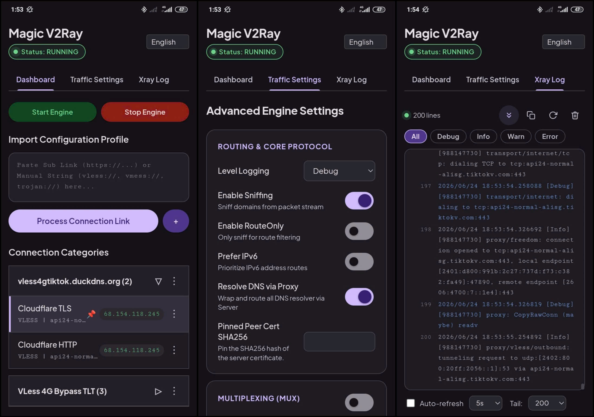

# Magic V2Ray (نسخه فارسی)

[Xem phiên bản Tiếng Việt](./README_vi.md) · [English README](./README_en.md)

یک مدیر پروکسی قدرتمند و ساده برای دستگاه‌های اندروید روت‌شده. با آن می‌توانید کل ترافیک دستگاه را از یک سرور پروکسی عبور دهید تا اتصالتان امن شود، محدودیت‌ها را دور بزنید و اینترنت پرسرعتتان را با دستگاه‌های دیگر به اشتراک بگذارید.

---

## Magic V2Ray چیست؟

**Magic V2Ray** یک ابزار شبکهٔ پیشرفته برای گوشی‌های اندرویدی روت‌شده است. با ترکیب هسته‌های پروکسی قوی، یک اتصال یکپارچهٔ سراسری ایجاد می‌کند که همهٔ اپ‌های شما را پوشش می‌دهد.

یک رابط وب تمیز دارد که در آن می‌توانید پیکربندی‌های پروکسی را مرتب کنید، لینک‌های اشتراک را ذخیره کنید و با چند کلیک شبکه‌تان را مدیریت کنید.

---

## چرا Magic V2Ray برای اندروید روت‌شده؟

اگر به برنامه‌های معمول V2Ray (مثل v2rayNG، Matsuri یا Nekobox) عادت دارید، این دلایل را ببینید:

- **پوشش سراسری و پایدار:** برنامه‌های معمولی در فضای کاربر و با API ‏`VpnService` اندروید کار می‌کنند و وقتی رم کم باشد، مدیریت حافظهٔ تهاجمی اندروید (Low Memory Killer) آن‌ها را می‌بندد. در نتیجه اتصال قطع می‌شود یا IP واقعی نشت می‌کند. Magic V2Ray با دسترسی روت کار می‌کند و به‌صورت دیمون سیستمی اجرا می‌شود که سیستم‌عامل زیر فشار حافظه نمی‌بندد.
- **رسیدن به ترافیکی که `VpnService` نمی‌بیند:** یک اپ `VpnService` فقط ترافیک UIDهایی را می‌بیند که فریم‌ورک به آن‌ها می‌دهد. Magic V2Ray بسته‌ها را در لایهٔ Netfilter علامت‌گذاری می‌کند، پس UIDهای سیستمی را هم پوشش می‌دهد. همچنین اسلات VPN سراسری سیستم را اشغال نمی‌کند، پس با VPN اختصاصی هر اپ تداخل ندارد و آیکون کلید VPN هم در نوار وضعیت نمی‌ماند.
- **پشتیبانی بومی از هات‌اسپات و اشتراک اینترنت:** `VpnService` نمی‌تواند ترافیک دستگاه‌های متصل به هات‌اسپات را حمل کند، چون اندروید آن ترافیک را خارج از فضای VPN فوروارد می‌کند. Magic V2Ray آن را در `PREROUTING` می‌گیرد و به همان تونل مسیریابی می‌کند، پس دستگاه‌هایی که هات‌اسپات شما را استفاده می‌کنند هم اتصال پروکسی‌شده دارند.
- **اتصال مجدد پویا و بی‌وقفه:** تغییر شبکه بین Wi-Fi و 4G/5G را از رویدادهای مسیریابی هسته (`ip monitor`) تشخیص می‌دهد، نه با پرس‌وجوی دوره‌ای، و علامت‌های مسیریابی را بدون انتظار برای timeout دوباره اعمال می‌کند.
- **پشتیبانی از روت‌های مختلف:** روی Magisk، KernelSU و APatch کار می‌کند.

---

## روت ندارید؟

> [!IMPORTANT]
> این یک **ماژول سیستمی** است (برای Magisk / KernelSU / APatch) و یک برنامهٔ مستقل **نیست**!

اگر گوشی‌تان روت نیست، یا برنامهٔ گرافیکی معمولی برای اندروید، ویندوز، macOS یا iOS می‌خواهید، کلاینت‌های رسمی و پشتیبانی‌شدهٔ جامعه را اینجا ببینید:
👉 **[کلاینت‌های گرافیکی Xray-core](https://github.com/xtls/xray-core#gui-clients)**

---

## امکانات اصلی

- **دسته‌بندی پیکربندی‌ها:** سرورهای پروکسی را در پوشه‌ها یا دسته‌های دلخواه گروه‌بندی کنید.
- **درون‌ریزی هوشمند لینک:** لینک اشتراک، رشته‌های پیکربندی خام یا متن ترکیبی را به‌راحتی بچسبانید.
- **به‌روزرسانی خودکار با یک تَپ:** لینک‌های اشتراک ذخیره می‌شوند تا کل یک دسته را با یک تَپ به‌روز کنید.
- **مصرف کم باتری:** پردازش بومی در پس‌زمینه باعث می‌شود باتری خیلی بیشتر از اجرای برنامه‌های VPN سنگین دوام بیاورد.
- **اشتراک اینترنت از طریق هات‌اسپات:** اتصال امن و پروکسی‌شدهٔ خود را از طریق Wi-Fi هات‌اسپات با لپ‌تاپ، کنسول یا گوشی‌های دیگر به اشتراک بگذارید، با پشتیبانی کامل از مسیریابی IPv4 و IPv6.

**توجه:** کاربران Magisk برای باز کردن WebUI ماژول باید [KsuWebUIStandalone](https://github.com/5ec1cff/KsuWebUIStandalone/releases/tag/v1.0) را نصب کنند.

---

## قدردانی و منابع

این پروژه از فایل‌های باینری آماده‌شدهٔ پروژه‌های متن‌باز زیر استفاده می‌کند:
* **[Xray-core](https://github.com/XTLS/Xray-core):** موتور اصلی که پروتکل‌های نسل بعدی پروکسی را مدیریت می‌کند.
* **[openxtun](https://github.com/vincentng295/openxtun):** پوستهٔ کوچکی که یک دستگاه TUN لینوکس را باز می‌کند و فایل‌دیسکریپتور آن را به Xray می‌دهد.
* **[curl-android](https://github.com/vvb2060/curl-android):** ابزار curl و کتابخانهٔ static libcurl برای اندروید.

## مجوز

این پروژه تحت مجوز **GNU General Public License v3.0 (GPL-3.0)** منتشر شده است.

با استفاده از این پروژه، شرایط و مقررات مندرج در مجوز را می‌پذیرید. برای جزئیات بیشتر به فایل [LICENSE](LICENSE) در همین مخزن مراجعه کنید.

به‌طور خلاصه، شما آزادید این نرم‌افزار را استفاده، تغییر و توزیع کنید، به شرط اینکه همان مجوز و دسترسی به سورس‌کد را در پروژهٔ خودتان هم نگه دارید.
